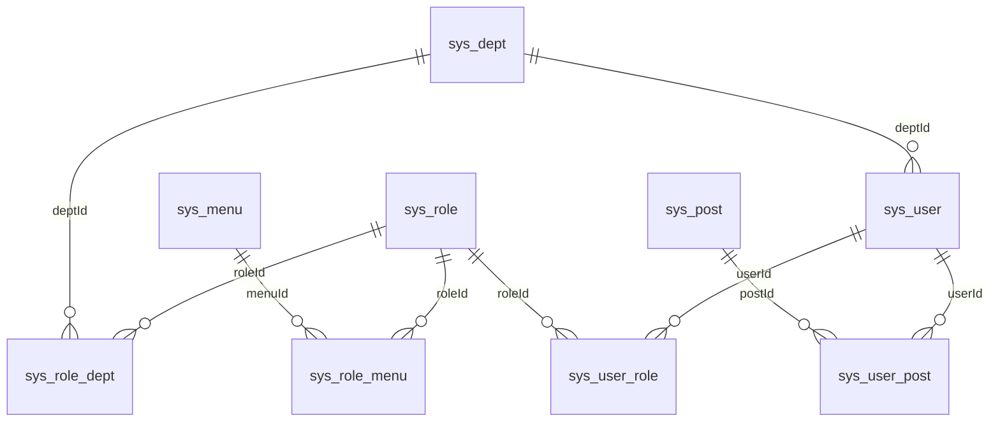
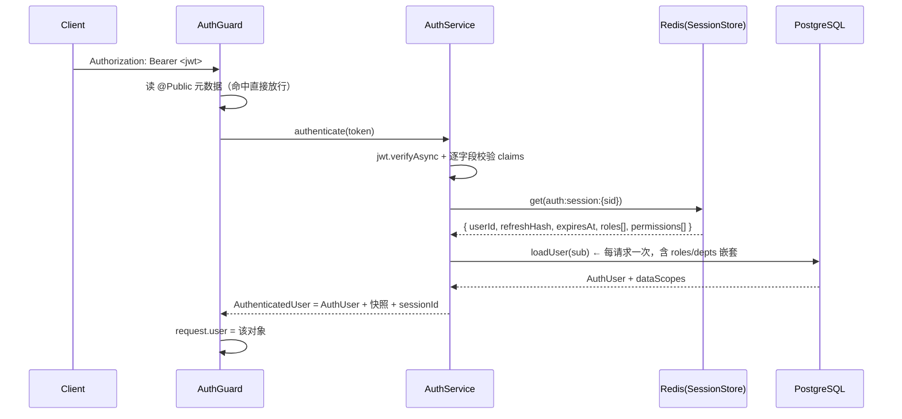
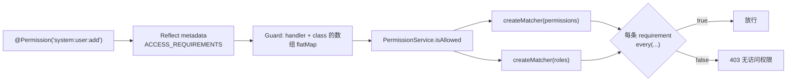
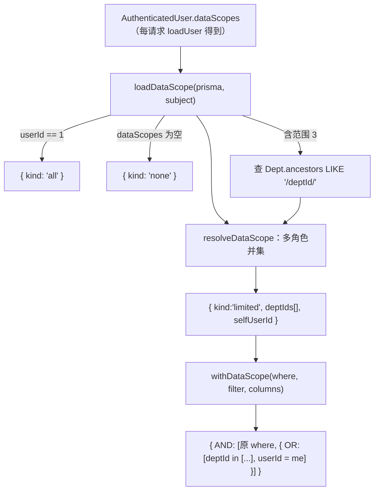
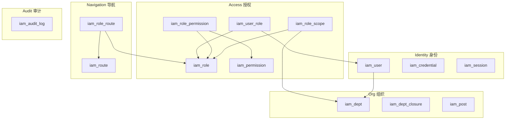
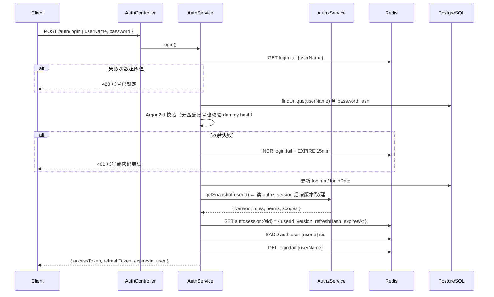
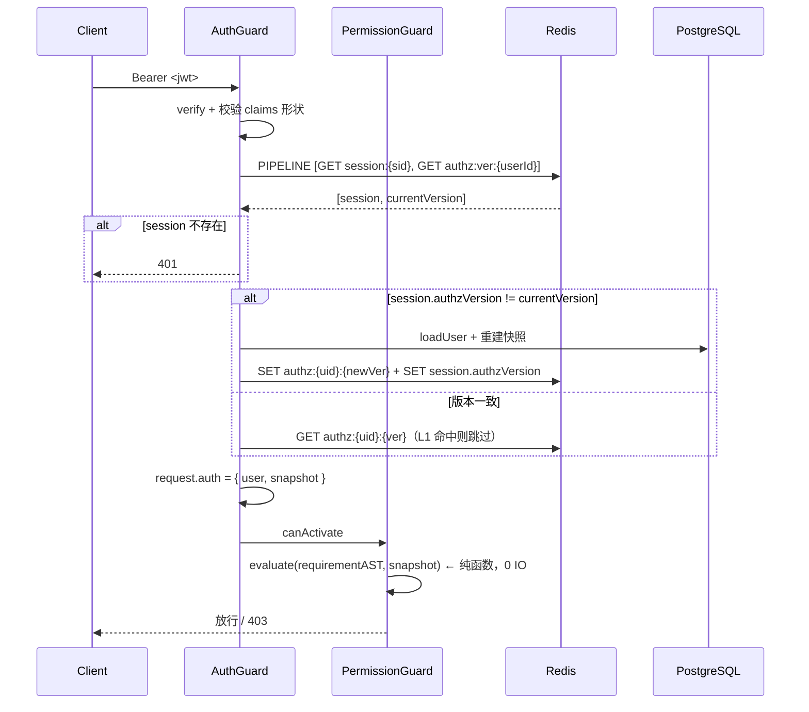
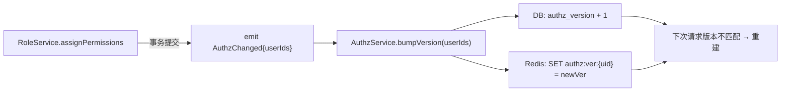
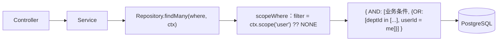

# RBAC 重构架构设计

> 状态：提案（Proposal）　读者：后端架构组 / 安全评审 / 前端负责人
> 基线：`nest-admin` 当前 `main`（NestJS 12 + Fastify + Prisma 7 + PostgreSQL + Redis）
> 范围：`libs/auth`、`libs/permission`、`apps/gateway/src/modules/system/*`、`prisma/models/*`
> 本文档**不改任何代码**，只定义目标架构与落地路径。

---

## 0. 结论先行

1. **现状不是"RBAC 写错了"，而是三个正交关注点被压进了两张表。** `sys_menu` 同时承载导航、路由、权限码；`sys_role` 同时承载功能授权与数据范围。所有可感知的问题（按钮权限要造菜单、删菜单被角色引用卡住、一个角色只能有一个数据范围）都是这一条的下游症状。重构主线是**拆分**，不是加功能。

2. **最危险的不是缺功能，是两条链路的安全基线相反。** 功能权限是**默认拒绝**：控制器没写 `@Permission` 就是 403（`permission.guard.ts:32-38`）。数据范围是**默认放行**：`withDataScope` 是纯函数（`data-scope.ts:180`），service 忘了调用就是全量可见，没有任何机制会报错。新架构必须把数据范围也变成默认拒绝。

3. **存在真实的提权路径。** 全仓没有"授予集合 ⊆ 自身集合"的约束。拥有 `system:role:assignMenus` 的部门管理员，可以把任意菜单（含自己没权限的）挂到一个新角色上，再用 `system:user:assignRoles` 把该角色分配给同部门同事，然后以同事身份登录。`user.service.ts:243` 只挡住了"改自己的角色"，挡不住这条链。

4. **性能上真正的浪费不是权限判定，是每请求查库。** 权限码走会话快照（好设计），但 `AuthService.authenticate` 每次请求都 `loadUser` 一次（`auth.service.ts:165`），Prisma 嵌套 `select` 会展开成多条 SQL。把快照改成"**版本号 + 懒重建**"，可以同时消掉这次查询和"改权限必须踢人"这个体验问题。

5. **落地节奏建议 9 个阶段，新表双写 + 影子判定灰度，不做一次性切换。** 最大的工程风险不是设计，而是 `prisma/migrations` 被 `.gitignore:60` 忽略——重构期几十张表的 DDL 没有版本控制，回滚能力为零。这件事必须在 Phase 0 先解决。

---

## 1. 现状（As-Is）

### 1.1 代码地图

| 层 | 文件 | 职责 | 规模 |
| --- | --- | --- | --- |
| 认证 | `libs/auth/src/auth.service.ts` | 签发/校验 JWT、会话读写、撤销 | 229 行 |
| 认证 | `libs/auth/src/session.store.ts` | Redis 会话、刷新令牌轮换（Lua 原子）、按用户批量撤销 | 148 行 |
| 认证 | `libs/auth/src/auth.guard.ts` | 全局守卫，解析 Bearer → 填充 `request.user` | 33 行 |
| 授权 | `libs/permission/src/permission.decorator.ts` | `@Permission` / `@Role` / `@Authenticated` 元数据 | 81 行 |
| 授权 | `libs/permission/src/permission.service.ts` | 要求求值（AND/OR + 角色兜底） | 52 行 |
| 授权 | `libs/permission/src/permission.constants.ts` | 超管短路、通配匹配 | 67 行 |
| 授权 | `libs/permission/src/prisma-permission.source.ts` | 登录时从 DB 计算快照 | 88 行 |
| 数据范围 | `libs/permission/src/data-scope.ts` | 范围解析、where 合成、部门子树 | 201 行 |
| 业务 | `apps/gateway/src/modules/system/{user,role,menu,dept,post}` | 5 个模块，service 合计 1426 行 | — |

守卫注册顺序在 `app.module.ts:34-37`：`AuthGuard` 先于 `PermissionGuard`，用 `useExisting` 保证单例。

### 1.2 数据模型



七张表 + 两张日志表。要点：

- **没有 `permission` 实体**。权限码是 `sys_menu.perms` 这一列上的字符串（`menu.prisma:42`），只在 `menuType ∈ {C, F}` 且 `status='0'` 时才被采集成权限（`prisma-permission.source.ts:77-84`）。
- **`Role.dataScope` 是单值**（`role.prisma:12`），一个角色对全系统只有一个数据范围。
- **`Dept.ancestors` 是物化路径字符串**（`dept.prisma:8`），含自身，形如 `/100/101/`。
- **没有审计表写入方**。`logs.prisma` 定义了 `LoginLog` / `OperLog`，但全仓没有任何代码写入它们。

### 1.3 认证链路



关键性质：

- **访问令牌不携带权限**，只带 `sub/sid/jti/iat/exp`（`auth.types.ts:57-63`）。权限从会话快照读，所以撤销会话 = 立即失效。
- **刷新令牌轮换有重放检测**：`ROTATE_REFRESH_TOKEN` Lua 脚本（`session.store.ts:23-40`）维护 `auth:used:{sid}` 集合，旧令牌二次使用会删会话。这是现状里做得最好的一块，重构应保留。
- **撤销粒度是"用户全部设备"**（`session.store.ts:133-147`），没有单设备下线接口（`logout` 只删当前 sid）。

### 1.4 授权链路



语义细节（重构必须原样继承的部分）：

| 规则 | 位置 | 说明 |
| --- | --- | --- |
| 多条注解之间固定 AND | `permission.guard.ts:25-38` | 类级 + 方法级一起 flatMap，全部要过 |
| 单条注解内默认 AND，可显式 OR | `permission.decorator.ts:39-42` | `@Permission({ value: [...], mode: Mode.OR })` |
| 角色可兜底权限 | `permission.service.ts:49` | `@Permission({ value, role })`，角色命中即整条通过 |
| 通配匹配 | `permission.constants.ts:45-52` | 仅授权侧支持 `*`，注解侧禁止（`normalizeValues` 校验） |
| 超管短路 | `prisma-permission.source.ts:68-70` | `userId === '1'` → `roles=['superadmin']`、`permissions=['*:*:*']` |
| 无注解 = 403 | `permission.guard.ts:32-38` | 认证通过但没有任何要求 → 拒绝 |

### 1.5 数据范围链路



三个设计取舍值得保留：

1. **数据范围不进会话快照**（`auth.types.ts:6-10`）。理由：只读角色 + `RoleDept`，挂在已有的用户查询上几乎零成本；不进快照意味着改 `Role.dataScope` **立即生效、不用踢人**。这个判断是对的，比 Java 版更准确。
2. **读写共用同一份并集条件**，即"可见即可改"。Java 在多角色时用 AND 串接各角色条件（部门角色 + 本人角色 → 必须同时满足），会把合法操作挡掉。
3. **空范围退化成 `IN ()` 恒假**（`data-scope.ts:195-199`），不退化成全量。失败关闭。

### 1.6 菜单权限链路

- 登录后 `GET /auth/menus` 返回**已授权可见的目录/菜单树**（`auth.service.ts:123-137`），只含 `M`/`C`，超管走全量分支。
- 普通用户分支要求 `status='0' && visible='0'`（`auth.service.ts:192`）；**超管分支不过滤 `visible`**（`auth.service.ts:150-152`），与 Java `selectMenuTreeAll` 一致——这是刻意保留的差异，前端自己处理隐藏项。
- 树的构造是"父节点不在集合里就丢弃该分支"（`auth.service.ts:130-136`），不重挂根。对比 `DeptService.findAll` 在受限时会重挂根（`dept.service.ts:57-62`）——**两处口径不一致**。

### 1.7 缺陷清单

按"安全 > 正确性 > 性能 > 可维护性"排序。每条都给出证据位置，便于复核。

| ID | 级别 | 问题 | 证据 |
| --- | --- | --- | --- |
| D-01 | 安全 | **数据范围默认放行**。范围靠 service 手工调 `withDataScope`，新增查询忘写即全量可见，无编译期/lint 约束 | `data-scope.ts:180`；`user.service.ts:61`、`dept.service.ts:47` 等 14 处手工调用 |
| D-02 | 安全 | **无授予约束，存在提权链**。`assignMenus`/`dataScope`/`assignRoles` 都不校验 actor 自身权限是否覆盖目标集合 | `role.service.ts:241-323`、`user.service.ts:240-283` |
| D-03 | 安全 | **无授权变更审计**。`OperLog`/`LoginLog` 模型存在但无写入方，谁在什么时候给谁加了什么权限无法追溯 | `logs.prisma:1-45`；全仓无 `operLog.create` |
| D-04 | 安全 | **无登录失败计数/锁定**，仅依赖全局 throttler；改密码不撤销会话（只有 `status` 变更才撤销） | `user.service.ts:232` |
| D-05 | 正确性 | **快照失效靠踢人，粒度粗且易漏**。`assignMenus` 撤销该角色全部用户会话，用户被迫重新登录；漏调一处即长期越权 | `role.service.ts:272`、`menu.service.ts:161` |
| D-06 | 正确性 | **`Role.dataScope` 是全局单值**，同一角色对"用户"和"部门"必须是同一范围，无法按资源差异化 | `role.prisma:12` |
| D-07 | 正确性 | **编码注释与实现不一致**。`role.prisma:11` 和 `auth.types.ts:14` 仍写 RuoYi 编码（2 自定义 / 5 本人 / 6 部门及以下或本人），实现是 `data-scope.ts:21-32`（2 本部门 / 5 自定义 / 无 6）。前端 `role/data.tsx:20-23` 与实现一致。DB 若出现 `'6'` 会被判配置异常直接 403 | `data-scope.ts:110-112` |
| D-08 | 正确性 | **权限码与菜单强耦合**。按钮必须挂在 `C` 菜单下，纯后端接口权限也得造一条 `F` 菜单；删菜单被角色引用直接拒绝，不能级联 | `menu.service.ts:29-42`、`menu.service.ts:174-175` |
| D-09 | 正确性 | **菜单物理删除**，与其余实体逻辑删除不一致，审计链断裂 | `menu.service.ts:176` |
| D-10 | 正确性 | **部门移动 O(n)**：全表加载 + BFS + 逐行 `update` 重写子树 `ancestors`，大树拖长事务；`Serializable` 无 P2034 重试 | `dept.service.ts:162-206` |
| D-11 | 正确性 | **受限范围下建不了根部门**：`isDeptInScope(filter, '0')` 恒 false，无测试锁定该行为 | `dept.service.ts:91`、`data-scope.ts:160-164` |
| D-12 | 性能 | **每请求 `loadUser` 查库**，Prisma 嵌套 `select` 展开为多条 SQL | `auth.service.ts:165` |
| D-13 | 性能 | **判定无缓存**：每次 `isAllowed` 重建两个 `Set` 并线性扫通配 | `permission.service.ts:38-39` |
| D-14 | 可维护性 | **权限码是散落字面量**：控制器 31 处 `@Permission`、28 个不同码，无注册表、无编译期校验，拼错即永久 403 且无人告警 | 5 个 controller |
| D-15 | 可维护性 | **数据范围拼装重复 14 处**，树形裁剪、写路径目标校验各自实现，口径已出现漂移（菜单不重挂根、部门重挂根） | `dept.service.ts:57-62` vs `auth.service.ts:130-136` |
| D-16 | 可维护性 | **判定语义分散三处**：注解 DSL、求值器、超管短路，无单一事实来源 | `permission.decorator.ts` + `permission.service.ts` + `prisma-permission.source.ts:68` |

---

## 2. 目标与非目标

### 2.1 设计原则

1. **默认拒绝**。功能权限、数据范围、路由可见性，三条链路都必须在"没有配置"时拒绝，而不是放行。这是与现状最大的差别。
2. **关注点分离**。导航（用户看到什么）、功能授权（用户能做什么）、数据范围（用户能看到哪些行）是三个独立决策，各自有独立的表、独立的失效通道、独立的测试。
3. **授权不可超越**。任何"授予"操作必须满足"授予集合 ⊆ 自身集合"，且不可授予高于自己等级的角色。这条要在领域层强制，不能靠 UI 隐藏。
4. **判定无副作用、可单测**。求值器是纯函数：输入 `(需求 AST, 快照)`，输出 `boolean`。不查库、不读 Redis、不看 request。
5. **范围注入不可绕过**。读路径的数据范围由仓储层强制，不靠 service 自觉。
6. **变更可追溯**。任何授权写操作产出审计记录，包含 before/after 与操作人。

### 2.2 非目标

- 不引入 ABAC / ReBAC（不做属性表达式、不做关系图遍历）。留扩展点，不实现。
- 不做多租户。`RESERVED_TENANT_ADMIN_ROLE_KEY` 继续作为保留标识存在，不落地租户隔离。
- 不替换 JWT + Redis 会话模型。现状的令牌设计是合理的，改造成本大于收益。
- 不做权限的"数据行级"细粒度（如"只能看金额 < 10000 的订单"）。那是 ABAC，明确排除。

### 2.3 验收标准

| 指标 | 目标 | 测量方式 |
| --- | --- | --- |
| 未授权访问拦截率 | 100% | 权限矩阵 e2e 全绿 |
| 数据范围漏注入 | 0 | ESLint 规则 + 仓储层类型约束 |
| 鉴权开销（快照命中） | p99 < 3ms | 压测 + trace span |
| 鉴权开销（快照重建） | p99 < 20ms | 压测 + trace span |
| 权限变更生效延迟 | ≤ 1 个请求 | 变更后下一次请求即生效 |
| 授权写操作审计覆盖率 | 100% | 审计表行数对账 |
| 权限码注册一致性 | 构建期失败 | CI 脚本 |

---

## 3. 领域建模（To-Be）

### 3.1 限界上下文



依赖方向：`Nav → Access → Org → Identity`，单向。`Audit` 被所有上下文写入，不反向依赖任何人。

### 3.2 三条分离线

这是整份文档最重要的一张表。

| 关注点 | 问题 | 存储 | 判定时机 | 失效方式 |
| --- | --- | --- | --- | --- |
| **功能授权** | 这个请求能不能做 | `iam_permission` + `iam_role_permission` | 每请求（快照） | 版本号 bump |
| **数据范围** | 这条 SQL 能返回哪些行 | `iam_role_scope` + `iam_role_scope_dept` | 每请求（快照，但独立字段） | 版本号 bump |
| **导航可见** | 侧边栏显示什么 | `iam_route` + `iam_role_route` | 登录后拉一次 | 前端重拉 |

现状把三者压在 `sys_menu`（导航 + 功能）+ `sys_role.dataScope`（数据）。拆开后：

- 新增一个后端接口权限，只写一行 `iam_permission`，**不需要造菜单**。
- 删一个路由，只影响 `iam_route`，不动权限码。
- 一个角色可以对"用户"是"本部门"、对"订单"是"全部"，互不干扰。

### 3.3 新表设计

命名统一 `iam_` 前缀，与现有 `sys_` 表并存以支持双写灰度；切换完成后 DROP 旧表。

#### 3.3.1 身份

```prisma
model User {
  userId        BigInt   @id @default(autoincrement()) @map("user_id")
  deptId        BigInt?  @map("dept_id")
  userName      String   @unique @map("user_name") @db.VarChar(64)   // 加唯一约束
  nickName      String   @map("nick_name") @db.VarChar(100)
  password      String   @db.VarChar(255)
  status        String   @default("0") @db.Char(1)
  delFlag       String   @default("0") @map("del_flag") @db.Char(1)
  /// 授权版本号：任何影响该用户授权快照的变更都 +1
  authzVersion  Int      @default(1) @map("authz_version")
  /// 登录失败计数与锁定截止时间（也可放 Redis，见 4.6）
  failedCount   Int      @default(0) @map("failed_count")
  lockedUntil   DateTime? @map("locked_until") @db.Timestamptz(6)
  createTime    DateTime @default(now()) @map("create_time") @db.Timestamptz(6)
  updateTime    DateTime? @updatedAt @map("update_time") @db.Timestamptz(6)
  @@index([deptId])
  @@map("iam_user")
}
```

> `userName` 加唯一约束是本设计的前置条件。现状 `sys_user.user_name` 无唯一约束，登录只能 `take: 2` 后判断"恰好一条"（`auth.service.ts:56-73`），这是个隐患——两个同名账号会让双方都登不进去，且无法从错误信息区分。

#### 3.3.2 组织

```prisma
model Dept {
  deptId     BigInt   @id @default(autoincrement()) @map("dept_id")
  parentId   BigInt   @default(0) @map("parent_id")
  deptName   String   @map("dept_name") @db.VarChar(64)
  orderNum   Int      @default(0) @map("order_num")
  leaderId   BigInt?  @map("leader_id")
  status     String   @default("0") @db.Char(1)
  delFlag    String   @default("0") @map("del_flag") @db.Char(1)
  createTime DateTime @default(now()) @map("create_time") @db.Timestamptz(6)
  @@index([parentId])
  @@map("iam_dept")
}

/// 部门闭包表：任意两节点的祖孙关系与层级深度
model DeptClosure {
  ancestorId   BigInt @map("ancestor_id")
  descendantId BigInt @map("descendant_id")
  depth        Int    @map("depth")
  @@id([ancestorId, descendantId])
  @@index([descendantId])
  @@map("iam_dept_closure")
}
```

**为什么用闭包表替代 `ancestors` 字符串**（见 ADR-03）。

#### 3.3.3 授权

```prisma
model Role {
  roleId     BigInt   @id @default(autoincrement()) @map("role_id")
  roleKey    String   @unique @map("role_key") @db.VarChar(64)
  roleName   String   @map("role_name") @db.VarChar(64)
  /// SYSTEM 内置（不可删改 key）、BUSINESS 业务角色
  roleType   String   @default("BUSINESS") @map("role_type") @db.VarChar(16)
  /// 角色等级：授予时要求 actor 的最高等级 >= 目标角色等级
  roleLevel  Int      @default(100) @map("role_level")
  status     String   @default("0") @db.Char(1)
  delFlag    String   @default("0") @map("del_flag") @db.Char(1)
  createTime DateTime @default(now()) @map("create_time") @db.Timestamptz(6)
  @@map("iam_role")
}

model Permission {
  permId     BigInt   @id @default(autoincrement()) @map("perm_id")
  /// 唯一权限码，形如 system:user:create；DB 中禁止出现 *
  code       String   @unique @db.VarChar(100)
  resource   String   @db.VarChar(64)
  action     String   @db.VarChar(32)
  name       String   @db.VarChar(100)
  /// LOW / MEDIUM / HIGH：HIGH 权限的授予需要二次确认与审计告警
  riskLevel  String   @default("LOW") @map("risk_level") @db.VarChar(16)
  status     String   @default("0") @db.Char(1)
  @@unique([resource, action])
  @@map("iam_permission")
}

model RolePermission {
  roleId BigInt @map("role_id")
  permId BigInt @map("perm_id")
  /// ALLOW / DENY；DENY 优先，用于"给某角色开大范围再点状收回"
  effect String @default("ALLOW") @db.VarChar(8)
  @@id([roleId, permId])
  @@index([permId])
  @@map("iam_role_permission")
}

model UserRole {
  userId    BigInt    @map("user_id")
  roleId    BigInt    @map("role_id")
  /// 临时授权窗口；null 表示长期有效
  validFrom DateTime? @map("valid_from") @db.Timestamptz(6)
  validTo   DateTime? @map("valid_to") @db.Timestamptz(6)
  grantedBy BigInt?   @map("granted_by")
  grantedAt DateTime  @default(now()) @map("granted_at") @db.Timestamptz(6)
  @@id([userId, roleId])
  @@index([roleId])
  @@map("iam_user_role")
}

/// 按资源的数据范围：一个角色对每个资源各有一条
model RoleScope {
  roleId    BigInt @map("role_id")
  /// 资源标识，与 Permission.resource 同一命名空间，如 user / dept / order
  resource  String @db.VarChar(64)
  /// ALL / DEPT / DEPT_AND_CHILD / SELF / CUSTOM
  scopeType String @map("scope_type") @db.VarChar(24)
  @@id([roleId, resource])
  @@map("iam_role_scope")
}

model RoleScopeDept {
  roleId   BigInt @map("role_id")
  resource String @db.VarChar(64)
  deptId   BigInt @map("dept_id")
  @@id([roleId, resource, deptId])
  @@index([deptId])
  @@map("iam_role_scope_dept")
}
```

#### 3.3.4 导航

```prisma
model Route {
  routeId    BigInt   @id @default(autoincrement()) @map("route_id")
  parentId   BigInt   @default(0) @map("parent_id")
  routeName  String   @map("route_name") @db.VarChar(64)
  /// DIR 目录 / PAGE 页面 / LINK 外链
  routeType  String   @map("route_type") @db.VarChar(8)
  path       String?  @db.VarChar(200)
  component  String?  @db.VarChar(255)
  icon       String?  @db.VarChar(100)
  orderNum   Int      @default(0) @map("order_num")
  visible    String   @default("0") @db.Char(1)
  /// 进入该路由需要的权限码；null 表示仅需登录。注意这是"路由级"要求，不承载按钮权限
  requiredPerm String? @map("required_perm") @db.VarChar(100)
  status     String   @default("0") @db.Char(1)
  @@index([parentId])
  @@map("iam_route")
}

model RoleRoute {
  roleId  BigInt @map("role_id")
  routeId BigInt @map("route_id")
  @@id([roleId, routeId])
  @@index([routeId])
  @@map("iam_role_route")
}
```

> 注意 `Route.requiredPerm` 与 `iam_role_route` 是**两套**：前者是"有权限才能进"，后者是"菜单给谁看"。同时存在是有意的——安全策略与产品策略不能混。

#### 3.3.5 审计

```prisma
model AuditLog {
  id         BigInt   @id @default(autoincrement())
  actorId    BigInt?  @map("actor_id")
  action     String   @db.VarChar(64)     // role.assignMenus / user.assignRoles / ...
  targetType String   @map("target_type") @db.VarChar(32)
  targetId   String   @map("target_id")   @db.VarChar(64)
  before     Json?
  after      Json?
  ip         String?  @db.VarChar(64)
  requestId  String?  @map("request_id") @db.VarChar(64)
  result     String   @default("OK") @db.VarChar(16)  // OK / DENIED
  createdAt  DateTime @default(now()) @map("created_at") @db.Timestamptz(6)
  @@index([actorId, createdAt])
  @@index([targetType, targetId])
  @@map("iam_audit_log")
}
```

### 3.4 关键决策与被否决方案

**ADR-01：权限码独立成表，不再寄存在菜单上。**
- 采纳：`iam_permission` 是唯一事实来源，菜单只做导航。
- 否决 A：继续用 `menu.perms`。理由：无法表达"没有 UI 的接口权限"，且删菜单会破坏权限。
- 否决 B：权限码只写在代码注解里，不入库。理由：无法给角色授权，也无法审计"谁有高危权限"。

**ADR-02：数据范围按 `(role, resource)` 建模，不是 `role.dataScope` 单值。**
- 采纳：`iam_role_scope`。
- 否决：`role.dataScope` + 一个"默认资源"。理由：早晚要按资源区分，越晚改代价越大。

**ADR-03：部门树用闭包表，不用物化路径字符串。**
- 采纳：`iam_dept_closure`。
  - 查子树：`SELECT descendant_id FROM iam_dept_closure WHERE ancestor_id = ?`，走主键索引。
  - 查祖先：`WHERE descendant_id = ?`，走二级索引。
  - 移动子树：删除"旧祖先 × 子树"的笛卡尔积行，插入"新祖先 × 子树"，代价 O(子树大小 × 深度)，与子树规模成正比而不是与全表成正比。现状是**全表加载 + 逐行 update**（`dept.service.ts:162-206`）。
  - Prisma 友好：普通复合主键表，不需要 `$queryRaw`。
- 否决 A：PostgreSQL `ltree` + GIST。技术更优（移动子树只改一行），但 Prisma 只能声明 `Unsupported("ltree")`，所有子树查询必须走 `$queryRaw`，丢掉类型安全和 `where` 组合能力。**如果后续确认 Prisma 支持改善，这是首选替代方案。**
- 否决 B：保留 `ancestors` 字符串。移动子树要重写所有后代的字符串，且子串匹配有前缀碰撞风险（现状用 `/${id}/` 规避）。

**ADR-04：快照用"版本号 + 懒重建"，不踢人。**
- 采纳：`iam_user.authz_version` + Redis `authz:ver:{userId}`，请求时比对，落后则重建。用户不会被强制登出。
- 否决：现状的"变更即撤销全部会话"（`role.service.ts:272`）。理由：一次菜单调整把全公司该角色的人踢下线，体验不可接受；而且漏调一处就是长期越权。
- 风险：版本号存在两处（DB 与 Redis）会不一致。以 DB 为准，Redis 只做缓存，重建时从 DB 读版本号回填。

**ADR-05：数据范围由仓储层强制，不用 Prisma 中间件隐式注入。**
- 采纳：`ScopedRepository` 基类 + ESLint 禁止 service 直接访问受保护模型。
- 否决：`Prisma.$extends` + `AsyncLocalStorage` 自动注入。理由：隐式注入让 SQL 不可预测、单测必须构造 ALS 上下文、`$queryRaw` 完全绕过；出问题时排查成本远高于收益。
- 代价：每个受保护模型要写一个仓储。可接受——目前只有 5 个。

**ADR-06：DENY 优先。**
- 采纳：`iam_role_permission.effect`，同一权限码同时被 ALLOW 和 DENY 时 DENY 胜出。
- 理由：没有 DENY，"给部门管理员开放全部权限再点状收回"这种常见诉求无法表达，只能靠拆角色，最终角色爆炸。

**ADR-07：保留 JWT + Redis 会话。**
- 否决：纯无状态 JWT（把权限塞进 token）。理由：撤销需要黑名单，等于还是要 Redis；且 token 会随权限变更变脏。
- 否决：Session Cookie 全服务端。理由：前端是 SPA + 多端，Bearer 更合适。

**ADR-08：超管继续用 `userId === 1` 判定。**
- 采纳：与 RuoYi 一致，是"系统不会被锁死"的最终保证（`user.service.ts:348-352` 挡住对 1 号用户的一切写操作）。
- 否决：用 `roleKey = 'superadmin'` 判定。理由：角色行可被误删/误改，`userId` 不会。两者同时存在（`SUPER_ADMIN_ROLE_KEY` 只用于快照里的角色标识）是正确的。

---

## 4. 认证模块（AuthN）

### 4.1 令牌与会话模型

| 对象 | 内容 | 存储 | TTL |
| --- | --- | --- | --- |
| Access Token | JWT：`sub`（userId）、`sid`（会话 ID）、`jti`、`iat`、`exp` | 客户端 | 15 min（可配） |
| Refresh Token | `${sid}.${32 字节 base64url}`，DB 只存 SHA-256 | 客户端 | 7 天（绝对期限） |
| Session | `{ userId, authzVersion, refreshHash, expiresAt }` | Redis `auth:session:{sid}` | 同 refresh |
| 用户会话索引 | `Set<sid>` | Redis `auth:user:{userId}` | 同 refresh |
| 授权版本 | `int` | Redis `authz:ver:{userId}`（无 TTL） | — |
| 授权快照 | `{ version, roles[], perms[], scopes{} }` | Redis `authz:{userId}:{version}` | 30 min |
| 快照 L1 | 同上，进程内 LRU | 进程内存 | 10 s |

**会话不再保存 `roles`/`permissions`**——这是与现状最大的结构差异。现状把快照塞进会话（`session.store.ts:11-16`），导致"多设备 = 多份快照 = 多份失效"，且撤销粒度只能是用户级。拆开后快照按 `(userId, version)` 缓存，天然被所有设备共享。

### 4.2 登录时序



关键点：

- **防枚举**：无匹配账号也执行同参数 Argon2id 校验（`auth.service.ts:47-50` 的 `dummyPasswordHash` 模式，保留）。
- **登录失败计数放 Redis**（`login:fail:{userName}`，滑动窗口 15 min，阈值 5），不用 DB 列，避免每次失败写库。
- **登录不返回权限**。前端拿到 token 后单独调 `GET /auth/profile`，与现状一致（`auth.controller.ts:48-54`）。

### 4.3 请求鉴权时序



**开销**：正常情况下 1 次 Redis pipeline（2 个 GET）+ 1 次进程内判定。**没有 DB 查询**。版本落后时才有 DB 查询。

对比现状：每请求 1 次 `loadUser`（含 2 个嵌套关系 → 约 3 条 SQL）+ 1 次 Redis GET。

### 4.4 快照重建

```ts
async function rebuild(userId: string): Promise<Snapshot> {
  const user = await prisma.user.findUnique({
    where: { userId: BigInt(userId) },
    select: {
      status: true, delFlag: true, deptId: true, authzVersion: true,
      roles: {
        where: { OR: [{ validTo: null }, { validTo: { gt: new Date() } }] },
        select: {
          role: {
            select: {
              roleKey: true, status: true, delFlag: true, roleLevel: true,
              permissions: { select: { effect: true, permission: { select: { code: true, status: true } } } },
              scopes: { select: { resource: true, scopeType: true, depts: { select: { deptId: true } } } },
            },
          },
        },
      },
    },
  });
  if (!user || user.status !== '0' || user.delFlag !== '0') throw new UnauthorizedException('未认证');

  // 超管：不读关联，直接全量（仍先校验用户有效，避免停用后仍放行）
  if (isSuperAdmin(userId)) {
    return { version: user.authzVersion, roles: ['superadmin'], perms: ALL, scopes: ALL_RESOURCES };
  }

  const allow = new Set<string>();
  const deny = new Set<string>();
  const scopes = new Map<string, RawScope[]>();
  for (const { role } of user.roles) {
    if (role.status !== '0' || role.delFlag !== '0') continue;
    for (const { effect, permission } of role.permissions) {
      if (permission.status !== '0') continue;
      (effect === 'DENY' ? deny : allow).add(permission.code);
    }
    for (const scope of role.scopes) push(scopes, scope.resource, scope);
  }
  for (const code of deny) allow.delete(code);   // DENY 优先

  return {
    version: user.authzVersion,
    roles: [...new Set(user.roles.map(r => r.role.roleKey))].sort(),
    perms: compileMatcher([...allow]),           // 精确 Set + 通配数组
    scopes: resolveScopes(scopes, user.deptId, userId),
  };
}
```

**版本号 bump 的触发点**（必须穷举，漏一个就是越权）：

| 变更 | bump 范围 |
| --- | --- |
| `iam_role_permission` 增删改 | 该角色下所有用户 |
| `iam_role_scope` / `iam_role_scope_dept` 变更 | 该角色下所有用户 |
| `iam_user_role` 增删 | 该用户 |
| `iam_role.status` / `roleKey` / `roleLevel` 变更 | 该角色下所有用户 |
| `iam_user.status` / `delFlag` / `deptId` 变更 | 该用户 |
| `iam_dept` 移动 / 删除 | 该部门下所有用户 + 所有引用该部门的 `RoleScope` 涉及用户 |
| `iam_permission.status` 变更 | 所有持有该权限的角色下用户 |
| `iam_role_route` 变更 | **不 bump**（导航不进快照，前端重拉即可） |

实现方式：领域事件 `AuthzChanged { userIds }`，由 service 在事务提交后发出，`AuthzService.bumpVersion` 消费。**不要**在事务内发——事务回滚了版本号已经涨了，会导致无谓重建（虽然不致命，但会掩盖真实问题）。

### 4.5 失败模式

| 故障 | 行为 | 理由 |
| --- | --- | --- |
| Redis 不可用 | 503 认证服务不可用 | 无法验证会话，失败关闭 |
| DB 不可用（重建时） | 503 | 同上 |
| 快照缓存损坏 | 丢弃并重建 | 校验 JSON 结构，不信任缓存 |
| 版本号读取失败 | 503 | 无法判断快照是否最新，宁拒绝 |

现状的 `SessionStore.execute` 把所有 Redis 异常统一转成 503（`session.store.ts:46-53`），这个做法正确，保留。

### 4.6 加固清单

1. **登录失败计数 + 锁定**：5 次 / 15 min，按 `userName` 与 `ip` 双维度，任一超限即拒绝。现状缺失。
2. **改密码撤销会话**：现状只在 `status` 变更时撤销（`user.service.ts:232`），改密码后旧 token 仍有效。必须在密码变更时 bump 版本 + 撤销该用户全部会话。
3. **单设备下线**：`DELETE /auth/sessions/:sid`，校验 sid 属于当前用户。
4. **会话列表**：`GET /auth/sessions`，返回设备、IP、最后活跃时间。
5. **MFA 挂载点**：登录第一步返回 `{ mfaRequired: true, ticket }`，第二步 `POST /auth/mfa/verify`。现在不实现，但表结构预留 `iam_credential.totp_secret`。
6. **令牌绑定**：可选 `UA hash` 写入会话，变更即要求重新登录（防 token 盗用）。

---

## 5. 授权模块（AuthZ）

### 5.1 需求表达式（Requirement AST）

把"注解 → 判定"从"数组 + 两个 mode 枚举"升级为表达式树。为什么必须升级：现状 `@Permission({ value, mode, role })` 只能表达"全部/任一"，无法表达"（有 A 且 B）或 超管"，也表达不了否定。需求一旦复杂，只能拆成多个注解，而多条注解之间**固定 AND**（`permission.guard.ts:25-38`），组合能力就锁死了。

```ts
export type Requirement =
  | { op: 'perm'; all?: readonly string[]; any?: readonly string[] }
  | { op: 'role'; any: readonly string[] }
  | { op: 'and'; of: readonly Requirement[] }
  | { op: 'or';  of: readonly Requirement[] }
  | { op: 'not'; of: Requirement }
  | { op: 'authenticated' };
```

### 5.2 注解 DSL

保持"简单场景一行搞定"，复杂场景可组合：

```ts
// 最常见：单个权限码
@RequirePermission('system:user:create')

// 任一即可
@RequirePermission({ any: ['system:user:update', 'system:user:assignRoles'] })

// 全部必须有
@RequirePermission({ all: ['order:read', 'order:approve'] })

// 角色兜底（现状能力，保留）
@RequirePermission({ any: ['system:user:list'], orRoles: ['auditor'] })

// 复杂组合：需要登录，且（有 A 或 有 B），且不是只读账号
@RequireAccess({
  op: 'and',
  of: [
    { op: 'authenticated' },
    { op: 'or', of: [{ op: 'perm', any: ['a'] }, { op: 'perm', any: ['b'] }] },
    { op: 'not', of: { op: 'role', any: ['readonly'] } },
  ],
})

// 仅需登录
@Authenticated()
```

**多条注解之间仍然是 AND**——这一点不变，避免语义漂移。要 OR 就用一个表达式。

### 5.3 求值器

```ts
export function evaluate(req: Requirement, snap: Snapshot): boolean {
  switch (req.op) {
    case 'authenticated':
      return true;                       // 守卫已保证
    case 'perm': {
      if (req.all?.some(code => !snap.has(code))) return false;
      if (req.any?.length && !req.any.some(code => snap.has(code))) return false;
      return true;
    }
    case 'role':
      return req.any.some(key => snap.roleSet.has(key));
    case 'and':
      return req.of.every(sub => evaluate(sub, snap));
    case 'or':
      return req.of.some(sub => evaluate(sub, snap));
    case 'not':
      return !evaluate(req.of, snap);
  }
}
```

性质（必须由单测锁定）：

- **纯函数**：无 IO、无时间依赖、无随机。给定 `(req, snap)` 结果确定。
- **短路**：`and` 遇到 false 立即返回，`or` 遇到 true 立即返回。
- **总函数**：`switch` 穷尽所有 `op`，TS 的 `never` 兜底保证新增 op 时编译失败。
- **不抛异常**：任何输入都返回 boolean。异常只可能来自快照构造阶段。

### 5.4 匹配语义

| 维度 | 规则 | 理由 |
| --- | --- | --- |
| 权限码格式 | `{domain}:{resource}:{action}`，小写 + 冒号，段数固定 3 | 可解析、可分组、可做前缀统计 |
| action 白名单 | `list / read / create / update / delete / export / import / assign / approve` | 现状 `add` / `edit` / `query` 混用（RuoYi 遗留），新码统一，旧码做别名映射 |
| 通配 | **只允许出现在超管注入的 `*:*:*`**，DB 与注解均禁止 `*` | 现状允许 DB 里写通配（`permission.constants.ts:45`），一个 `*` 就能让权限审计失去意义 |
| 角色匹配 | 精确字符串，不支持通配 | 角色是标识不是模式 |
| 大小写 | 全部小写，写入时校验 | 避免 `System:User:Create` 与 `system:user:create` 并存 |

### 5.5 缓存分层

| 层 | Key | TTL | 命中率预期 | 失效 |
| --- | --- | --- | --- | --- |
| L1 进程内 LRU | `userId:version` | 10 s 或 1000 条上限 | 高（同一用户短时间多次请求） | 版本变化天然失效 |
| L2 Redis | `authz:{userId}:{version}` | 30 min | 中 | 版本变化天然失效 |
| L3 DB | — | — | — | — |

版本号参与 key，**不存在"缓存脏了"这种情况**——旧版本的 key 直接不再被访问，靠 TTL 自然淘汰。这是这套设计最省心的地方。

L1 的价值：高频接口（列表页轮询）下省掉 Redis RTT。代价是多实例间可能短暂不一致（最多 10 s），对授权可接受。

### 5.6 失效传播



要点：

- **不删缓存，只 bump 版本**。删除是 O(用户数 × 设备数) 的写放大，bump 是 O(用户数)。
- **bump 失败必须告警但不能回滚业务**。业务事务已提交，回滚会丢数据。残留影响是"旧权限继续生效到快照 TTL（30 min）"。这是可接受的降级，但要进监控。
- **bump 用 pipeline**，一批用户一次 RTT。

### 5.7 授予约束（防提权）

这是现状完全缺失、必须在领域层强制的一组不变量：

```ts
/** 授予者不能给出自己没有的权限。 */
function assertGrantable(actor: Snapshot, codes: string[]): void {
  const missing = codes.filter(code => !actor.has(code));
  if (missing.length) throw new ForbiddenException(`不能授予自己不具备的权限：${missing.join(',')}`);
}

/** 授予者不能操作等级高于自己的角色。 */
function assertRoleLevel(actorMaxLevel: number, target: Role): void {
  if (target.roleLevel < actorMaxLevel) throw new ForbiddenException('不能操作高于自身等级的角色');
}

/** 授予者不能把角色分配给等级高于自己的用户，也不能操作自己。 */
function assertAssignable(actor: Snapshot, actorId: string, targetUser: User): void {
  if (targetUser.userId === actorId) throw new ConflictException('不能修改自己的角色');
  if (targetUser.maxRoleLevel < actor.maxRoleLevel) throw new ForbiddenException('不能操作等级更高的用户');
}
```

三条不变量覆盖了 D-02 描述的整条提权链。测试要求：每条不变量至少一个正向用例 + 两个反向用例（同级、越级）。

---

## 6. 数据权限（DataScope）

### 6.1 语义定位

**数据范围不是权限，是过滤器。** 它不回答"能不能做这个操作"（那是功能权限），只回答"这个查询能看到哪些行"。这个区分带来三个推论：

1. 数据范围**不产生 403**。范围为空时返回空列表，不是拒绝。唯一的例外是写操作的目标校验（见 6.6）。
2. 数据范围**不参与 AND/OR 组合**。多角色之间永远是并集（可见范围取最大），不存在"必须同时满足"。
3. 数据范围**必须默认拒绝**。没有配置 = 看不到任何数据，而不是看到全部。这与现状相反（现状空范围退化成恒假是好的，但"忘写 `withDataScope`"退化成全量是坏的）。

### 6.2 建模

```
iam_role_scope(roleId, resource, scopeType)
iam_role_scope_dept(roleId, resource, deptId)   -- 仅 scopeType = CUSTOM
```

`resource` 与 `Permission.resource` 同一命名空间。一个角色对 `user` 是 `DEPT_AND_CHILD`，对 `order` 是 `ALL`，是两条独立记录。

**五个 scopeType**（与现状编码保持一致，避免前端字典改动）：

| 值 | 名称 | 解析结果 |
| --- | --- | --- |
| `ALL` | 全部数据 | `{ kind: 'all' }` |
| `DEPT` | 本部门 | `{ kind: 'limited', deptIds: [actor.deptId] }` |
| `DEPT_AND_CHILD` | 本部门及以下 | `{ kind: 'limited', deptIds: 闭包表子树 }` |
| `SELF` | 仅本人 | `{ kind: 'limited', selfUserId: actor.userId }` |
| `CUSTOM` | 自定义 | `{ kind: 'limited', deptIds: RoleScopeDept 集合 }` |

> **现状的编码坑**：`role.prisma:11` 与 `auth.types.ts:14` 的注释仍写 RuoYi 编码（2 自定义 / 5 本人 / 6 部门及以下或本人），实现是 2 本部门 / 5 自定义 / 无 6（`data-scope.ts:21-32`）。前端 `role/data.tsx:20-23` 与实现一致。重构时必须**删除旧注释**并给 `scopeType` 用字符串枚举而非 `'1'..'5'`——数字码的可读性代价已经在这里付过一次了。

### 6.3 合并规则

```ts
function resolveScopes(raw: RawScope[], deptId: string | null, userId: string, subtree: string[]): ScopeMap {
  const result: ScopeMap = new Map();
  for (const [resource, list] of raw) {
    if (list.some(s => s.scopeType === 'ALL')) { result.set(resource, ALL); continue; }
    const deptIds = new Set<string>();
    let self = false;
    for (const s of list) {
      switch (s.scopeType) {
        case 'DEPT':            if (deptId) deptIds.add(deptId); break;
        case 'DEPT_AND_CHILD':  subtree.forEach(id => deptIds.add(id)); break;
        case 'CUSTOM':          s.deptIds.forEach(id => deptIds.add(id)); break;
        case 'SELF':            self = true; break;
        default:                throw new ForbiddenException(`资源 ${resource} 的范围配置异常`);
      }
    }
    result.set(resource, deptIds.size || self
      ? { kind: 'limited', deptIds: [...deptIds], selfUserId: self ? userId : null }
      : NONE);                                  // 空 → 拒绝，不是全量
  }
  return result;
}
```

三条硬规则：

1. 任一角色 `ALL` → 该资源不受限。
2. 其余全部并集。`CUSTOM` **不自动展开下级**（与 RuoYi 一致，也符合"自定义"的直觉）。
3. 合并后为空 → `NONE`。**绝不退化成 `ALL`。**

`scopeMap.get(resource) ?? NONE` —— 这个 `??` 是"默认拒绝"的落点。

### 6.4 注入点：ScopedRepository

```ts
export interface ScopeColumns {
  readonly dept?: string;   // 部门归属列，如 'deptId'
  readonly self?: string;   // 归属人列，如 'userId'；没有就不支持 SELF
}

export abstract class ScopedRepository<TRow> {
  protected abstract readonly model: string;
  protected abstract readonly columns: ScopeColumns;

  constructor(protected readonly prisma: PrismaService) {}

  /** 所有读方法都必须经过这里，没有例外。 */
  protected scopeWhere(where: object, ctx: AuthContext): object {
    const filter = ctx.scope(this.model);       // 缺省 NONE
    if (filter.kind === 'all') return where;
    const branches: object[] = [];
    if (filter.kind === 'limited') {
      if (this.columns.dept && filter.deptIds.length)
        branches.push({ [this.columns.dept]: { in: filter.deptIds.map(BigInt) } });
      if (this.columns.self && filter.selfUserId)
        branches.push({ [this.columns.self]: BigInt(filter.selfUserId) });
    }
    if (!branches.length) {
      const col = this.columns.dept ?? this.columns.self;
      if (!col) throw new Error(`${this.model} 缺少归属列，无法应用数据范围`);
      branches.push({ [col]: { in: [] } });
    }
    return { AND: [where, branches.length === 1 ? branches[0] : { OR: branches }] };
  }

  findMany(where: object, ctx: AuthContext, args?: object) { /* ... */ }
  findById(id: bigint, ctx: AuthContext) { /* 返回 null 而非抛错 */ }
  update(id: bigint, data: object, ctx: AuthContext) { /* 先 findById 校验 */ }
  remove(id: bigint, ctx: AuthContext) { /* 先 findById 校验 */ }
}
```

**强制手段**（这一条决定架构能不能落地）：

```js
// eslint.config.mjs
{
  files: ['apps/**/*.service.ts'],
  rules: {
    'no-restricted-syntax': ['error', {
      selector: "MemberExpression[object.property.name='prisma'][property.name=/^(user|dept|role|route|order)$/]",
      message: '业务 service 不得直接访问受数据范围保护的模型，请通过对应 Repository。',
    }],
  },
}
```

现状 14 处 `withDataScope` 全部是"自觉调用"，没有强制。这条 lint 规则是把"自觉"换成"编译失败"的最低成本方案。

### 6.5 读路径



树形结构的裁剪规则必须统一（现状两处不一致，见 D-15）：

- **部门树**：受限时，父节点不可见的节点**重挂到根**（`dept.service.ts:57-62` 的做法），否则 `toTree` 会当数据损坏抛 409。
- **菜单树**：**丢弃**不可见分支（`auth.service.ts:130-136` 的做法）。
- 新架构：把"裁剪策略"做成枚举 `TreePruneMode = 'REPARENT' | 'DROP'`，由仓储层参数显式指定，不允许各 service 自己决定。

### 6.6 写路径

写路径比读路径多三条校验，缺一条就是越权：

```ts
// create：目标部门必须在范围内
async create(dto, ctx) {
  assertTargetInScope(ctx.scope('user'), dto.deptId);        // 否则 403
  // ... 事务内再校验部门存在/启用（防 TOCTOU）
}

// update：旧值可见 + 新值在范围内
async update(id, dto, ctx) {
  const current = await repo.findById(id, ctx);              // 不可见 → null → 404
  if (!current) throw new NotFoundException();
  if (dto.deptId !== undefined) assertTargetInScope(ctx.scope('user'), dto.deptId);
}

// delete：旧值可见
async remove(id, ctx) {
  const current = await repo.findById(id, ctx);
  if (!current) throw new NotFoundException();
}
```

**"不可见"一律返回 404，不返回 403。** 现状已经这么做（`user.service.ts:97-105` 注释明确），保持。理由：403 会泄露"这条记录存在"。

**根节点特例**：`assertTargetInScope(filter, '0')` 在受限范围下必然 false，导致受限管理员建不了根部门（D-11）。新设计显式定义：根部门创建只允许 `ALL` 范围或超管，作为**业务规则写进文档与测试**，而不是让它成为一个偶然的副作用。

### 6.7 部门树查询

```sql
-- 子树（DEPT_AND_CHILD）
SELECT descendant_id FROM iam_dept_closure WHERE ancestor_id = $1;
-- 祖先链（面包屑、移动校验）
SELECT ancestor_id FROM iam_dept_closure WHERE descendant_id = $1 ORDER BY depth DESC;
```

索引：`PRIMARY KEY (ancestor_id, descendant_id)` 覆盖子树查询；`INDEX (descendant_id)` 覆盖祖先查询。

移动子树的事务：

```sql
-- 1. 找出被移动子树
CREATE TEMP TABLE moved AS SELECT descendant_id FROM iam_dept_closure WHERE ancestor_id = $deptId;
-- 2. 删除旧外部祖先 → 子树 的关系
DELETE FROM iam_dept_closure
WHERE descendant_id IN (SELECT descendant_id FROM moved)
  AND ancestor_id NOT IN (SELECT descendant_id FROM moved);
-- 3. 插入新祖先 → 子树 的关系
INSERT INTO iam_dept_closure (ancestor_id, descendant_id, depth)
SELECT a.ancestor_id, m.descendant_id, a.depth + m.depth + 1
FROM (SELECT ancestor_id, depth FROM iam_dept_closure WHERE descendant_id = $newParentId
      UNION ALL SELECT $newParentId, 0) a
CROSS JOIN moved m;
```

复杂度 O(子树大小 × 新祖先深度)，与全表规模无关。现状是全表加载 + BFS + 逐行 update（`dept.service.ts:162-206`）。

### 6.8 一致性与性能

| 场景 | 现状 | 新设计 |
| --- | --- | --- |
| 查子树 | `ancestors LIKE '%/id/%'`，索引难用满 | 闭包表主键索引，等值查询 |
| 移动子树 | 全表加载 + O(n²) BFS + 逐行 update | 3 条集合 SQL |
| 部门删除 | 检查 4 张表引用 | 同，但闭包表级联删除需显式处理 |
| 范围解析 | 每请求查一次 `Dept.ancestors`（仅范围 3） | 子树结果进快照，TTL 30 min |

**范围进快照的代价**：部门树变动后，已缓存的快照里子树是旧的。解决：部门移动/删除时 bump 所有受影响用户的版本号（见 4.4 表）。这个成本可接受——部门调整是低频操作。

---

## 7. 菜单与路由

### 7.1 职责拆分

| 表 | 回答 | 谁消费 |
| --- | --- | --- |
| `iam_route` + `iam_role_route` | 侧边栏显示什么 | 前端路由生成器 |
| `iam_permission` + `iam_role_permission` | 按钮/接口能不能用 | 后端守卫 + 前端 `v-access` |

现状把两者绑在 `sys_menu` 上，后果是：给某人"查看用户"权限，就必须同时给他"系统管理"菜单，否则他看不到入口；反过来，有菜单但没权限码会渲染出一个点了就 403 的按钮。

### 7.2 动态路由生成

```ts
async function buildRoutes(userId: string): Promise<RouteNode[]> {
  if (isSuperAdmin(userId)) {
    return tree(await prisma.route.findMany({ where: { status: '0' } }));
  }
  const rows = await prisma.route.findMany({
    where: {
      status: '0',
      visible: '0',
      roles: { some: { role: { users: { some: { userId: BigInt(userId) } }, status: '0', delFlag: '0' } } },
    },
    orderBy: [{ orderNum: 'asc' }, { routeId: 'asc' }],
  });
  return tree(rows, { prune: 'DROP' });   // 父不可见则整枝丢弃
}
```

与现状的两点差异：

1. **超管也过滤 `visible`**？不。保持现状（超管看全量，前端自己处理 `visible`），因为超管需要能配置隐藏菜单。但要在文档里写清这是**有意的例外**。
2. **树的裁剪策略显式化**（`prune: 'DROP'`），不再是隐式行为。

### 7.3 前端按钮权限

```vue
<!-- 有 system:user:create 才渲染 -->
<a-button v-access:code="'system:user:create'">新增</a-button>

<!-- 任一即可 -->
<a-button v-access:code="['system:user:update', 'system:user:assignRoles']">编辑</a-button>
```

权限码来自 `GET /auth/profile`（现状已有，`auth.controller.ts:48-54`）。**前端隐藏只是体验，不是安全边界**——后端守卫必须独立校验，这条在现状里已经做对。

### 7.4 一致性 CI

三个检查脚本，进 CI，任一失败阻断合并：

1. **注解 ↔ 权限表**：扫描 `@RequirePermission(...)` / `@RequireAccess(...)` 字面量，与 `iam_permission.code` 比对。缺失 → 失败。
2. **权限表 ↔ 迁移**：`iam_permission` 的每一行必须能追溯到某个迁移文件或种子文件，防止手工改库。
3. **前端 ↔ 后端**：扫描前端 `v-access:code` 字面量，与权限表比对。缺失 → 警告（不阻断，前端可能引用未上线的权限）。

现状完全没有这层校验（D-14），一个拼错的权限码表现为"这个按钮永远 403"，且没有任何日志会告诉你原因。

---

## 8. 实施路线

九个阶段，每个阶段可独立上线、独立回滚。总周期按 2 人全职估算约 10 周。

| 阶段 | 目标 | 关键交付 | 退出条件 |
| --- | --- | --- | --- |
| P0 | 基线冻结 | 权限矩阵快照、migrations 入库 | DDL 有版本控制 |
| P1 | 新表落地 | `iam_*` 全套 + 回填脚本 + 对账 | 双表数据一致 |
| P2 | 权限码抽离 | `iam_permission` + 构建期校验 | 注解全部可解析 |
| P3 | 判定引擎 | AST + 求值器 + 适配层 | 影子判定零差异 |
| P4 | 快照版本化 | `authzVersion` + 懒重建 | 不再踢人 |
| P5 | 数据范围重构 | `iam_role_scope` + Repository | lint 规则生效 |
| P6 | 路由分离 | `iam_route` + 前端改造 | 菜单不再承载权限 |
| P7 | 授予约束与审计 | 不变量 + `iam_audit_log` | 提权用例全红 |
| P8 | 旧表下线 | DROP `sys_*` | 零引用 |

### P0 基线冻结（3 天）

1. **`prisma/migrations` 纳入版本控制**。现状 `.gitignore:60` 忽略它，意味着重构期所有 DDL 不可回滚。改 `.gitignore`，把历史迁移补提交。
2. 导出当前权限矩阵：`userId × endpoint → 200/403/404`，作为重构后的对照基线。
3. 记录现有 31 处 `@Permission` 注解、28 个权限码到 `docs/rbac-permission-inventory.md`。
4. 在 `libs/permission` 加判定埋点（`authz_decision_total{result}`），采集一周真实流量。

**回滚**：无代码变更，纯文档与配置。

### P1 新表落地（1.5 周）

1. 建 `iam_user` / `iam_dept` / `iam_dept_closure` / `iam_role` / `iam_permission` / `iam_role_permission` / `iam_user_role` / `iam_role_scope` / `iam_role_scope_dept` / `iam_route` / `iam_role_route` / `iam_audit_log`。
2. 写回填脚本 `script/migrate-rbac-v2.mjs`：`sys_*` → `iam_*`，幂等（`ON CONFLICT DO NOTHING`），按依赖顺序 dept → closure → post → permission → role → role_permission → user → user_role → route → role_route。
3. **`sys_menu.perms` → `iam_permission` 的去重逻辑**：同一 `perms` 可能挂在多条菜单上，取 `MIN(menu_id)` 作为来源，记录 `source_menu_id` 便于溯源。
4. 写对账脚本 `script/verify-rbac-v2.mjs`：逐表比对行数与关键字段，输出差异报告。
5. **双写**：`sys_*` 写操作同步写 `iam_*`（过渡期），读仍走 `sys_*`。

**回滚**：DROP `iam_*`，删双写代码。

### P2 权限码抽离（1 周）

1. 生成 `libs/permission/src/registry.ts`：从 `iam_permission` 导出的静态常量表（构建期生成，不运行时查库）。
2. 新增 `@RequirePermission` 时**必须**引用常量而非字面量：`@RequirePermission(PERM.USER_CREATE)`。
3. CI 脚本校验注解字面量与注册表一致。
4. 旧码别名映射：`add → create`、`edit → update`、`query → read`，在 `iam_permission` 里保留 `legacy_code` 列，过渡期双查。

**回滚**：保留字面量注解，删除注册表。

### P3 判定引擎（1.5 周）

1. 实现 `Requirement` AST + `evaluate`（纯函数，100% 单测覆盖）。
2. `@Permission` 编译成 AST 的适配层：`{ value, mode, role }` → `{ op:'perm', all/any, }`，语义与现状逐条对齐（含"角色兜底"）。
3. **影子判定**：请求同时跑旧判定与新判定，结果不一致时打 `authz_shadow_mismatch` 日志，仍以旧结果为准。
4. 影子运行 3 天零差异后切换。

**回滚**：开关切回旧判定（保留双实现一个版本）。

### P4 快照版本化（1 周）

1. 加 `iam_user.authz_version`，初始化为 1。
2. 会话结构从 `{ roles, permissions }` 改为 `{ authzVersion }`（Redis key 不变，字段兼容：读不到 `authzVersion` 视为 0 → 强制重建）。
3. 实现 `AuthzService.bumpVersion(userIds)`，替换全部 `revokeSessionsOf` 调用点。
4. 灰度：先对 10% 用户启用（按 `userId % 10`），观察重建率与 p99。

**回滚**：恢复会话内快照，`bumpVersion` 退化成 `revokeSessionsOf`。

### P5 数据范围重构（2 周）

1. `iam_role_scope` 回填：`role.dataScope` → `(roleId, '*', scopeType)` 的默认资源条目，再按资源拆分。
2. 实现 `ScopedRepository` 基类，先迁移 `user` 模块（范围语义最复杂，先啃硬骨头）。
3. 加 ESLint 规则，迁移一个模块开一个模型的禁用列表。
4. **影子模式**：新旧范围同时计算，比较生成的 `where` 是否等价（结构化比较，不是字符串比较），差异打日志。
5. 五个模块全部迁移完成后，删除 `withDataScope` 的直接调用。

**回滚**：删除 lint 规则，恢复 `withDataScope` 调用（保留一个版本）。

### P6 路由分离（1 周）

1. `sys_menu` 拆成 `iam_route`（导航）+ `iam_permission`（已在 P2 完成）。
2. `/auth/menus` 改为从 `iam_route` 生成，前端同步改造（`route` 字段结构基本不变，`perms` 字段移除）。
3. 前端 `v-access` 改为引用权限码常量。

**回滚**：`/auth/menus` 保留旧实现一个版本，按 header 开关切换。

### P7 授予约束与审计（1 周）

1. 三条不变量（5.7）落到 service 层，先只记录不阻断（观察模式），一周后改为阻断。
2. `iam_audit_log` 写入：所有授权写操作，含 `before`/`after` 快照。
3. 高危权限（`riskLevel = HIGH`）的授予触发告警（webhook / 日志 ERROR）。

**回滚**：关闭阻断开关。

### P8 旧表下线（3 天）

1. 全仓 grep 确认 `sys_user` / `sys_role` / `sys_menu` / `sys_dept` / `sys_post` / 关联表零引用。
2. 写迁移 DROP 旧表（保留一个版本的数据备份表 `sys_*_backup`）。
3. 删除 `libs/permission/src/data-scope.ts` 里的旧编码注释与别名逻辑。

**回滚**：从备份表恢复（这就是 P0 要求 migrations 入库的原因）。

---

## 9. 迁移与灰度

| 手段 | 用法 | 风险 |
| --- | --- | --- |
| 双写 | P1-P5 期间 `sys_*` 与 `iam_*` 同时写 | 写失败导致不一致 → 对账脚本每日跑 |
| 影子读 | 新逻辑算但不生效，只比结果 | 日志量大 → 采样 10% |
| 按用户灰度 | `userId % 100 < N` 走新链路 | 同一用户行为不一致 → 灰度期间禁止跨版本操作 |
| 按接口灰度 | 新链路只对 `GET` 生效，写接口最后切 | 读写范围口径不一致 → 只在读路径稳定后再切写 |
| 开关 | 每个阶段一个独立开关，配置中心控制 | 开关组合爆炸 → 开关只允许"全旧/全新"，不允许混搭 |

**迁移期必须遵守的两条纪律**：

1. **任何时刻只有一个事实来源**。双写期间以 `sys_*` 为准，`iam_*` 是副本；切换后反过来。不允许"读 A 写 B"。
2. **对账失败即回滚**。每日跑 `verify-rbac-v2.mjs`，差异 > 0 就停止推进，先查原因。

---

## 10. 测试策略

### 10.1 权限矩阵（核心）

参数化 e2e，`endpoint × principal` 全组合：

| 主体 | 期望 |
| --- | --- |
| 超管（userId=1） | 全部 200 |
| 全权限角色 | 全部 200 |
| 只读角色 | `list`/`read` → 200，其余 403 |
| 无角色用户 | 全部 403 |
| 停用用户 | 全部 401 |
| 已删用户 | 全部 401 |
| 无 token | 全部 401 |
| 过期 token | 全部 401 |
| 已撤销会话 | 全部 401 |

现状 `test/rbac.e2e-spec.ts` 已有雏形（9 条端点 × 认证/权限两层），扩展成矩阵即可。

### 10.2 不变量测试

```ts
// 数据范围：空范围必须返回空列表，不能返回全量
it('无任何范围配置时返回空列表', async () => { /* ... */ });

// 数据范围：多角色取并集，不是交集
it('部门角色 + 本人角色 → 能看到本部门全部 + 自己', async () => { /* ... */ });

// 写路径：不能把记录创建到范围外
it('受限用户创建到范围外部门返回 403', async () => { /* ... */ });

// 越权读：不可见返回 404 而不是 403
it('读取范围外用户返回 404', async () => { /* ... */ });

// 授予约束：不能授予自己没有的权限
it('授予超出自身权限的菜单返回 403', async () => { /* ... */ });

// 授予约束：不能给自己加角色
it('修改自己的角色返回 409', async () => { /* ... */ });
```

### 10.3 求值器单测

`evaluate` 是纯函数，用表驱动覆盖：每种 `op` × 边界（空数组、重复码、DENY 覆盖 ALLOW、`not` 嵌套）。目标行覆盖率 100%，分支覆盖率 100%。

### 10.4 性能测试

| 场景 | 目标 |
| --- | --- |
| 快照命中（L1） | p99 < 1ms |
| 快照命中（Redis） | p99 < 3ms |
| 快照重建 | p99 < 20ms |
| 1000 并发 / 10 万用户 | 无 Redis 热点 key（版本 key 天然分散） |

---

## 11. 可观测性与审计

### 11.1 指标

| 指标 | 类型 | 用途 |
| --- | --- | --- |
| `authz_decision_total{result,reason}` | counter | 拒绝率突增告警 |
| `authz_rebuild_total{trigger}` | counter | 重建风暴检测（版本 bump 过频） |
| `authz_snapshot_hit_total{layer}` | counter | L1/L2/DB 命中率 |
| `authz_scope_none_total{resource}` | counter | 空范围告警（可能是配置错误） |
| `authz_shadow_mismatch_total` | counter | 迁移期专用，必须为 0 |
| `auth_session_active{role}` | gauge | 在线会话数 |

### 11.2 审计

`iam_audit_log` 的写入点（一个都不能漏）：

- `role.create/update/delete`
- `role.assignPermissions`（记录 before/after 权限码集合）
- `role.setScope`（记录 before/after 范围）
- `user.assignRoles`
- `user.update`（仅当 `status` / `deptId` 变更时）
- `user.resetPassword`
- `permission.create/update`
- `route.assign`

审计写入**必须在业务事务内**（同库同事务），否则会出现"权限改了但没审计"。

### 11.3 Trace

鉴权链路打一个 span `authz.authorize`，包含属性：`user.id`、`authz.version`、`authz.cache`（l1/l2/db）、`authz.result`、`authz.requirement`（AST 的 hash，不打原文）。重建单独一个 span `authz.rebuild`，含 SQL 耗时。

---

## 12. 风险清单

| ID | 风险 | 影响 | 缓解 |
| --- | --- | --- | --- |
| R-01 | `prisma/migrations` 未入库 | 重构期 DDL 不可回滚 | P0 必须先解决 |
| R-02 | 双写不一致 | 切换后权限错乱 | 每日对账 + 差异即停 |
| R-03 | 范围收紧导致业务不可用 | 用户突然看不到数据 | 影子模式先跑一周，对比"如果生效会少看到多少行" |
| R-04 | 版本号 bump 漏点 | 长期越权 | bump 触发点写成表格 + 单测逐条覆盖 |
| R-05 | 权限码迁移丢失 | 某功能永久 403 | P2 的 CI 校验 + P0 的权限矩阵基线对照 |
| R-06 | 前端改造滞后 | 菜单空白 | P6 保留旧 `/auth/menus` 一个版本 |
| R-07 | 闭包表维护遗漏 | 子树查询错 | 部门写操作全部走 `DeptRepository`，禁止直连 |
| R-08 | 审计日志膨胀 | 库容量 | 按月分区，保留 12 个月 |

---

## 附录 A：权限码规范

**格式**：`{domain}:{resource}:{action}`，全小写，段数固定 3，用 `:` 分隔。

| 段 | 取值 | 示例 |
| --- | --- | --- |
| domain | `system` / `business` / `report` | `system` |
| resource | 名词单数，与 `iam_permission.resource` 一致 | `user`、`order` |
| action | 白名单：`list read create update delete export import assign approve` | `create` |

**迁移映射**（现状 28 个码 → 新码）：

| 旧 | 新 | 备注 |
| --- | --- | --- |
| `system:user:list` | `system:user:list` | 不变 |
| `system:user:query` | `system:user:read` | 改名 |
| `system:user:add` | `system:user:create` | 改名 |
| `system:user:edit` | `system:user:update` | 改名 |
| `system:user:delete` | `system:user:delete` | 不变 |
| `system:user:assignRoles` | `system:user:assign` | 改名 |
| `system:role:assignMenus` | `system:role:assign` | 改名 |
| `system:role:dataScope` | `system:role:assign` | **合并**（同一动作的两个面） |
| 其余 `list/query/add/edit/delete` | 同规则 | — |

> 合并 `assignMenus` 与 `dataScope` 是有意的：它们都是"配置角色的授权"，拆成两个码只会让人少授一个然后来问为什么。

---

## 附录 B：错误码

| 场景 | HTTP | code | message |
| --- | --- | --- | --- |
| 无 token / token 无效 | 401 | 401 | 未认证 |
| 会话已撤销 | 401 | 401 | 未认证 |
| 账号停用/删除 | 401 | 401 | 未认证 |
| 登录失败 | 401 | 401 | 账号或密码错误 |
| 账号锁定 | 423 | 423 | 账号已锁定，请稍后重试 |
| 无功能权限 | 403 | 403 | 无访问权限 |
| 越权写目标部门 | 403 | 403 | 无权操作目标部门 |
| 授予超出自身权限 | 403 | 403 | 不能授予自己不具备的权限 |
| 记录不可见 | 404 | 404 | 记录不存在 |
| 范围配置异常 | 403 | 403 | 角色数据范围配置异常 |
| Redis/DB 不可用 | 503 | 503 | 认证服务不可用 |

现状的响应封装是 `{ code, data, message }`（`response.interceptor.ts` + `all-exceptions.filter.ts`），保持不变。

---

## 附录 C：与现状的差异速查

| 维度 | 现状 | 新设计 |
| --- | --- | --- |
| 权限码存储 | `sys_menu.perms` | `iam_permission.code` |
| 数据范围粒度 | 角色级单值 | `(角色, 资源)` |
| 数据范围注入 | service 手工调 `withDataScope` | Repository 强制 + ESLint |
| 功能权限默认 | 拒绝（无注解 403） | 拒绝 |
| 数据范围默认 | **放行**（漏写即全量） | 拒绝（`?? NONE`） |
| 权限变更生效 | 撤销会话，用户重新登录 | 版本 bump，无感重建 |
| 每请求 DB 查询 | 1 次 `loadUser` | 0 次（版本命中时） |
| 部门树 | `ancestors` 物化路径 | 闭包表 |
| 部门移动 | 全表加载 + 逐行 update | 3 条集合 SQL |
| 菜单删除 | 物理删除 | 逻辑删除 |
| 授予约束 | 无 | 三条不变量 |
| 审计 | 无 | `iam_audit_log` |
| 权限码校验 | 无 | 构建期 CI |
| 组合能力 | 单条 AND/OR + 多注解 AND | AST 任意组合 |
| 超管判定 | `userId === '1'` | 不变 |
| 令牌模型 | JWT + Redis 会话 | 不变 |

---

## 附录 D：本文档生成用的提示词（可复用）

```text
在 docs/ 下新建文档，不改动任何代码。
角色：企业级系统架构师（IAM 方向）。
目标：给出"推翻现有 RBAC 并重建"的完整架构方案，不是对现有实现的说明书。

输入约束：
- 必须基于仓库真实现状：libs/auth、libs/permission、
  apps/gateway/src/modules/system/*、prisma/models/*、.gitignore、package.json。
- 每个结论都要能指到文件:行；没有证据的推断必须标注"推测"。

必须覆盖：
1) 现状（代码地图、ER、认证时序、授权判定、数据范围、菜单链路）
2) 缺陷清单，按 安全 > 正确性 > 性能 > 可维护性 排序，逐条给证据
3) 从 0 的领域建模：限界上下文、表结构（字段/索引/约束/为什么）、关联关系
4) 认证：令牌、会话、快照、失效、失败模式、加固
5) 授权：需求表达式 AST、注解 DSL、求值器、匹配语义、缓存分层、失效传播、授予约束
6) 数据范围：语义定位、按资源建模、合并规则、注入点与强制手段、读写路径、树结构
7) 菜单与路由分离、动态路由算法、按钮权限、一致性 CI
8) 分阶段实施路线：每阶段交付物、退出条件、回滚方式
9) 迁移灰度、测试策略（权限矩阵）、可观测性、审计、风险清单

写作要求：
- 结论先行，第一章就给判断。
- 每个设计决策写"为什么"，并列出被否决的方案及否决理由（ADR 形式）。
- 给可执行的伪代码与 SQL 形态，不写"可以考虑"这类空话。
- 不要为了完整性堆砌与本项目无关的通用 RBAC 理论。
```
